After studying Chapter 3 of *CS:APP*, I have developed a mental model of x86-64 assembly programming. At its core, everything revolves around three entities: the CPU, registers, and memory. Instructions move data between them, transform data stored in them, and control the flow of execution based on their contents.

<!--more-->

## Overview

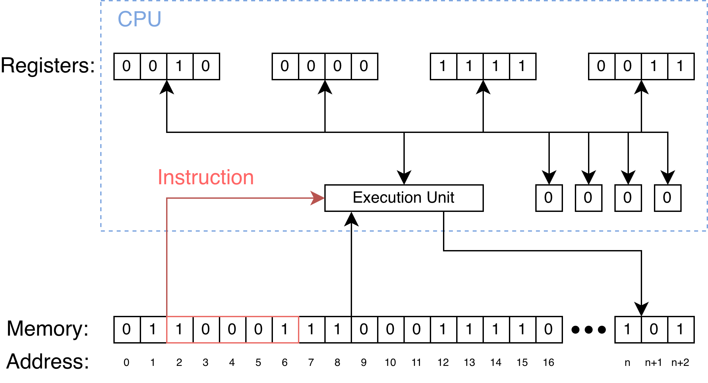

When an x86-64 program is executed, the **CPU** fetches an **instruction** from **memory**, decodes it, and performs the specified operation. For example, it may read values from two registers, add them together, and write the result back to a register or a memory location. It then fetches the next instruction and repeats this process continuously until the program terminates.

As the diagram shows, everything stored in memory or registers is composed of a **sequence of bits**. Each bit has exactly one value: either 0 or 1. To locate an instruction or a piece of data, it is necessary to know its starting position, known as an **address**, and its length.

There is no inherent difference between an instruction and data stored in memory. The distinction depends on the **context**. If the CPU interprets a sequence of bits as data, then it is data; if the CPU interprets the same bits as an instruction, then it is an instruction. As *CS:APP* says, information is **bits + context.**

## IP: Instruction Pointer

We already know that whether a sequence of bits is interpreted as an instruction or as data depends on the context. But what exactly is this context? In x86, one key part of the answer is a special register called the **Instruction Pointer (IP)**, which is also known as the **Program Counter (PC)**.

The IP holds the address of the first byte of the next instruction to be executed. Since x86 instructions can have different lengths, the CPU must decode each instruction to determine where it ends and where the next one begins.

Once the current instruction has been executed, the CPU uses the instruction pointer to locate the next instruction. The IP is then updated to reflect the next execution address, allowing the CPU to continue executing the program one instruction at a time.

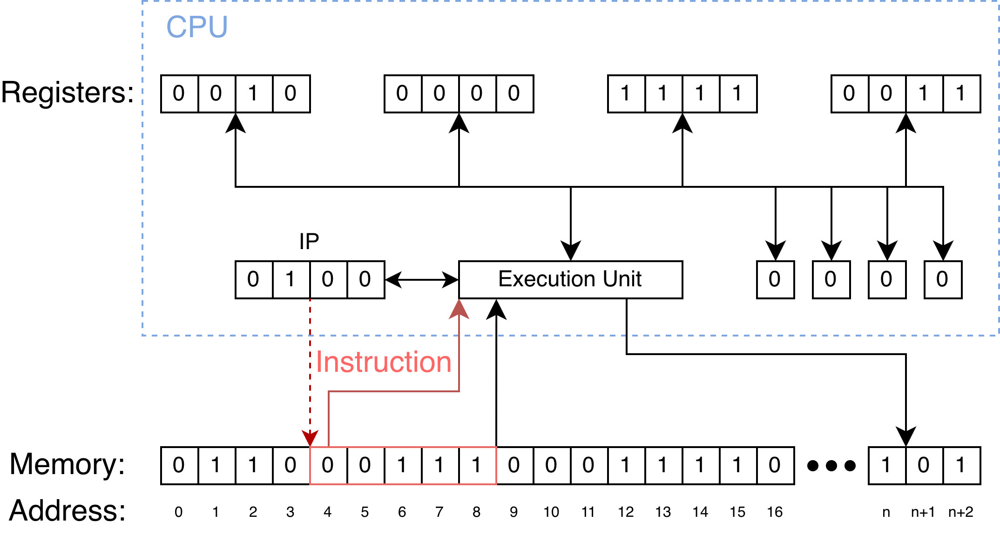

At this point, it may seem that the CPU can only execute instructions sequentially, one after another. But that would be too limiting. There must be a way to make the *IP* point to an address other than that of the next sequential instruction.

In fact, some instructions can modify the *IP* to change the flow of execution. These instructions allow the CPU to jump to a different location in the program, deciding what to execute next. This is the basis of conditional branching, loops, and function calls.

After all, the *IP* is a register, and its value can be changed by some instructions—not just advanced to the next instruction.

## Byte: The Real Unit of Addressing

Actually, we don't use the bit as the unit of addressing. It's too fine-grained: addresses would need very large numbers. Instead, we use the byte, a group of 8 bits. This way, a much smaller address can cover the same amount of memory.

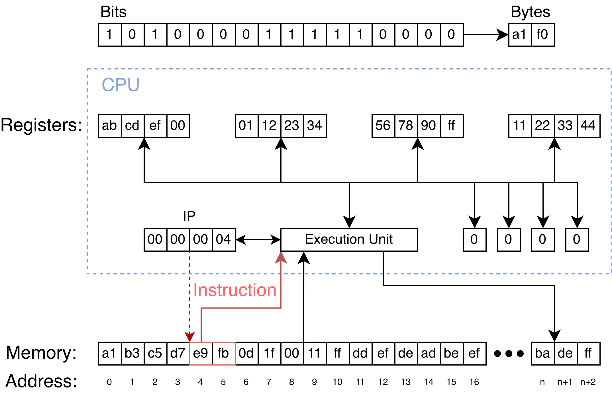

## Operands: How to Name Things

Now that we know a machine has an execution unit, memory, and a set of registers (one of which holds the address of the next instruction), it's time to learn how to refer to these things in assembly code.

### Immediate Values

An *immediate* is a constant value encoded directly in an instruction, rather than a value that the instruction must retrieve from a register or a separate memory location. Examples include the numbers 1, 2, and 3.

In assembly syntax, an immediate value is prefixed with `$`. For example, to represent the immediate value 1, we write `$1`.

### Registers

Each register has a name, which we can use to refer to it in assembly code. Register names are prefixed with `%`. For example, `%rax` refers to the 64-bit `RAX` register.

Unlike the IP, which can only be set by special instructions (such as `jmp`, `call` and `ret`), some registers are designed for general-purpose use. They include `ax`, `bx`, `cx`, `dx`, `di`, `si`, `sp`, `bp`, and `r8`–`r15`.

See Appendix: General-Purpose Registers.

### Memory Address

A common form of a memory address syntax is `Imm(%b, %i, s)`, where:

1. `Imm` is an optional immediate displacement, specified without the `$` prefix.
2. `%b` is an optional register that holds a base address, known as the *base register*.
3. `%i` is an optional register that holds an index value, known as the *index register*.
4. `s` is an optional scale factor that can be `1`, `2`, `4`, or `8`. It determines the multiplier applied to the index value.

Each component is optional, although the scale factor is meaningful only when an index register is specified.

The effective memory address is calculated as: `Imm + %b + %i * s`.

Any omitted component is treated as zero, except that an omitted scale factor defaults to `1` when an index register is present.

## Moving Data

Now we have the core components: the CPU, the registers, and the memory. We already know how to represent them, so it's time to manipulate the data.

A move instruction has the general form `MOV S, D`, where `S` stands for "Source", which can be an immediate, a memory address, or a register, and `D` stands for "Destination", which can be a memory address or a register. A move instruction copies data from the source to the destination.

When the source is a memory address, the destination can only be a register. Thus, we can't move data directly between two memory addresses.

For example, to load the register `ax` with the value stored at the address `19`, we can write:
```assembly
movq 19, %rax
```

Here, the `movq` instruction has a suffix `-q` and the register `ax` has a prefix `r-`. Both indicate that the operation works on 64-bit values.

See Appendix: Instructions.

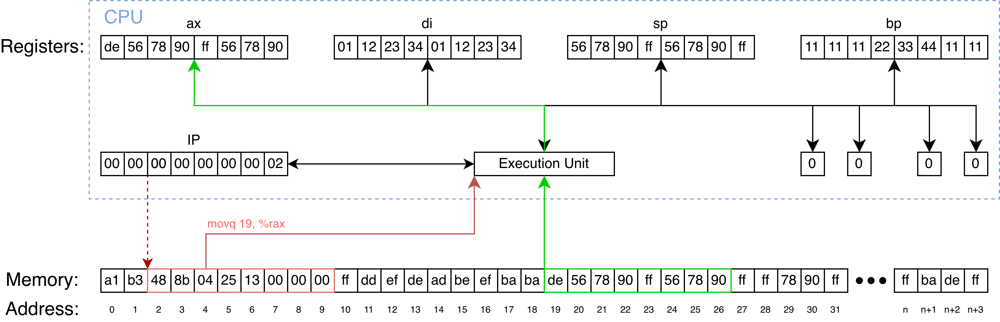

## Transforming Data

### Arithmetic Instructions

Now we know how to move data between registers and memory. It's time to compute with it.

Arithmetic instructions operate on one or two operands and store the result in the destination. For example, `ADD S, D` adds `S` to `D` and stores the sum in `D`, overwriting its previous value.

```assembly
addq %rax, %rdi
```

### Flag Registers

There are 4 special registers: `ZF`, `SF`, `OF`, `CF`, which are designed to represent the status of the last operation. Almost all of the arithmetic instructions will set those registers.

| Name | Meaning       | Condition                                                     |
| ---- | ------------- | ------------------------------------------------------------- |
| ZF   | Zero Flag     | Yielded 0                                                      |
| SF   | Sign Flag     | Yielded negative                                               |
| OF   | Overflow Flag | Overflow for signed                                            |
| CF   | Carry Flag    | Carry out of the most significant bit (overflow for unsigned)  |

For example, when adding two 4-bit numbers:
```
0111 + 0001 = 1000
```

The result is not `0`, so `ZF` is set to `0`.
If the result is treated as a signed number, it is negative and a signed overflow has occurred, so `SF` and `OF` are set to `1`.
If the result is treated as an unsigned number, there is no carry out of the most significant bit, so `CF` is set to `0`.

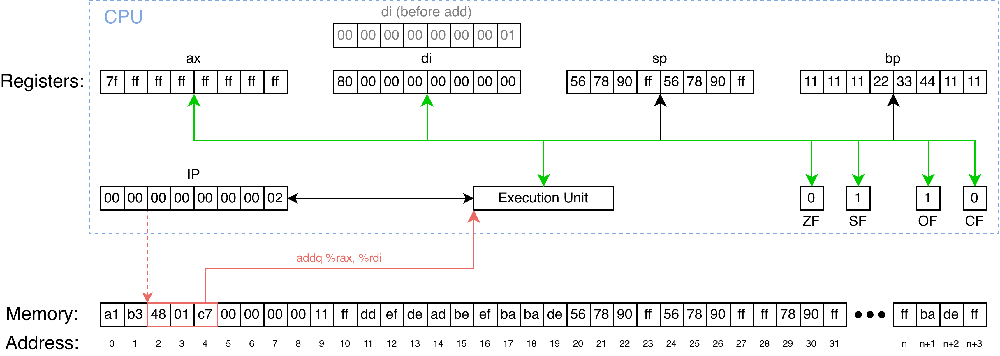

## Controlling the Flow

We can combine the condition flags to test whether the result of the previous instruction satisfies a condition, which lets us implement control flow.

### Compare

Two instructions set the flags without modifying their operands:
```assembly
CMP S1, S2    # Set the flags according to S2 - S1.
TEST S1, S2   # Set the flags according to S1 & S2. (Usually used as `TEST S1, S1` to check whether S1 is 0.)
```

### Jump

Now we can change which instruction executes next by setting the IP with a jump instruction. There are three kinds:

```assembly
jmp .LABEL     # unconditional jump to LABEL.
jmp *Operand   # Operand: register or memory address. Unconditional jump to the address stored in the operand.
J .LABEL       # jump to LABEL if the condition given by the suffix is satisfied.

.LABEL:        # marks the next instruction; defined as `<name>:`. The assembler replaces it with that instruction's address.
```

For example, jump if the value of `%rax` is equal to the value of `%rbx`:
```assembly
cmpq %rax, %rbx
je .LABEL
<some instructions>
.LABEL:
<some instructions>
```

Here are the suffixes used by the conditional jump instructions:

| Suffix | Condition      | Description      |
| ------ | -------------- | ---------------- |
| e      | ZF             | Equal            |
| ne     | ~ZF            | Not Equal        |
| s      | SF             | Negative         |
| ns     | ~SF            | Nonnegative      |
| g      | ~(SF^OF) & ~ZF | Greater          |
| ge     | ~(SF^OF)       | Greater or equal |
| l      | SF^OF          | Less             |
| le     | (SF^OF) \| ZF  | Less or equal    |
| a      | ~CF & ~ZF      | Above            |
| ae     | ~CF            | Above or equal   |
| b      | CF             | Below            |
| be     | CF \| ZF       | Below or equal   |

## Procedures

### SP & BP: Run-Time Stack

A program may need to handle far more data than the number of registers can hold. A technique called the runtime stack was designed to solve this problem. It uses two registers, `sp` and `bp`, to mark the two ends of a region of memory (the current stack frame), and the memory between them is used to store data.

Two instructions move values onto and off the stack:

```assembly
pushq S # %rsp <- %rsp - 8, (%rsp) <- S
S: {Imm, Reg, Mem}

popq D  # D <- (%rsp), %rsp <- %rsp + 8
D: {Reg, Mem}
```

Note that the stack is located at high addresses and grows downward: pushing data decreases the value of `sp`, and popping data increases it.

Here is a typical procedure:

```assembly
pushq %rbp
movq %rsp, %rbp     # Save the original address of sp to the bp
subq $20, %rsp      # Allocate 20 bytes for the stack
<some instructions>
movq %rbp, %rsp     # Free the stack by setting the sp to its original address
popq %rbp
```

#### Step-by-Step Diagrams: Lifecycle of a Stack Frame

The diagrams below trace this instruction sequence, one step per instruction:

```assembly
pushq %rbp
movq %rsp, %rbp
pushq %rax
movq %rbp, %rsp
popq %rbp
popq %rdi
```

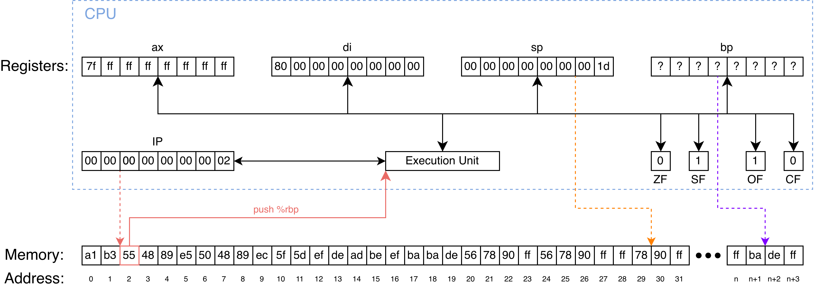

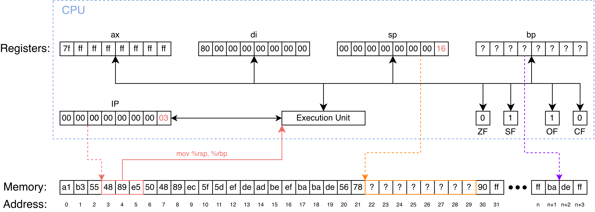

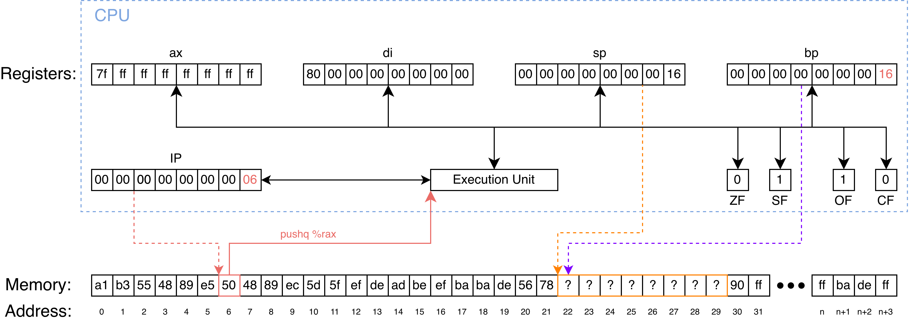

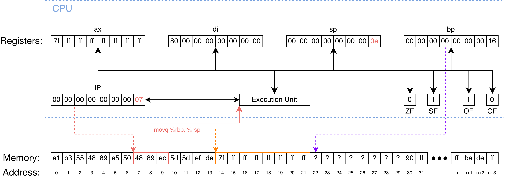

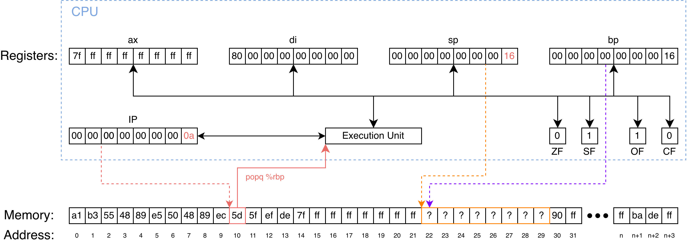

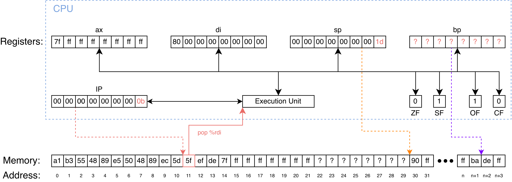

### Function Call

What needs to happen when a function is called? First, the next instruction must be set to the first instruction of the callee. Second, some arguments may need to be passed to the callee. Finally, when the callee is done, execution must resume at the instruction right after the call site, possibly with a return value.

#### Calling and Return

Two instructions handle function calls, giving us the ability to jump to the callee and return to the right place afterwards:
```assembly
call Label       # Procedure call: push the return address and jump to the Label
call *Operand    # Procedure call: push the return address and jump to the indirect address
ret              # Return from call: pop the address to the PC
```

The callee places the return value, if any, in `ax`.

#### Passing Arguments

The first six arguments are passed in these registers, in order: `di`, `si`, `dx`, `cx`, `r8`, and `r9`. Any further arguments are passed on the stack.

#### Callee-Saved Registers

Some registers are designated as callee-saved, which means the callee must preserve their values: when the function returns, they must hold the same values as when it was called. Therefore, a function that wants to use a callee-saved register must first save its value (for example, with `push`) and restore it (with `pop`) before returning.

#### Local Variables

A function may store local variables on the stack, so its frame contains a region for them, located between the saved callee-saved registers and the outgoing arguments area used for the next function call.

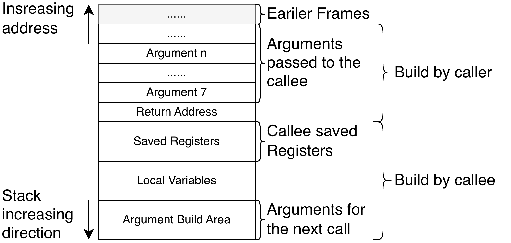

#### Step-by-Step Diagrams: Calling a Function and Returning Immediately

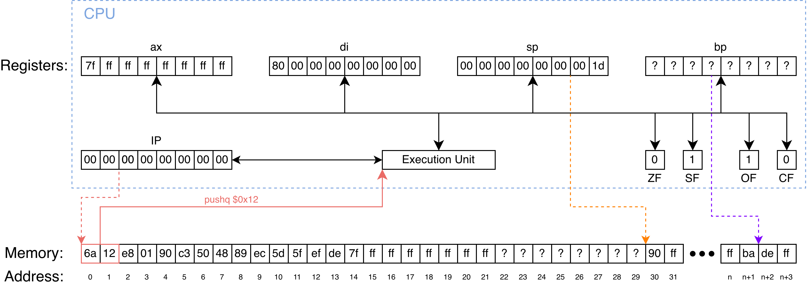

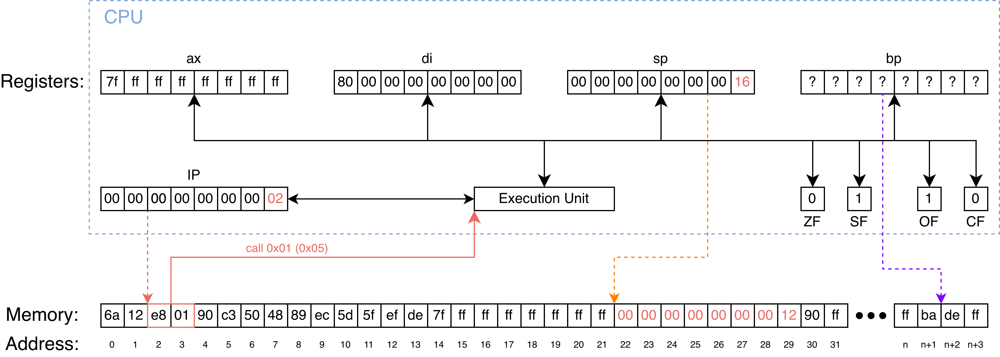

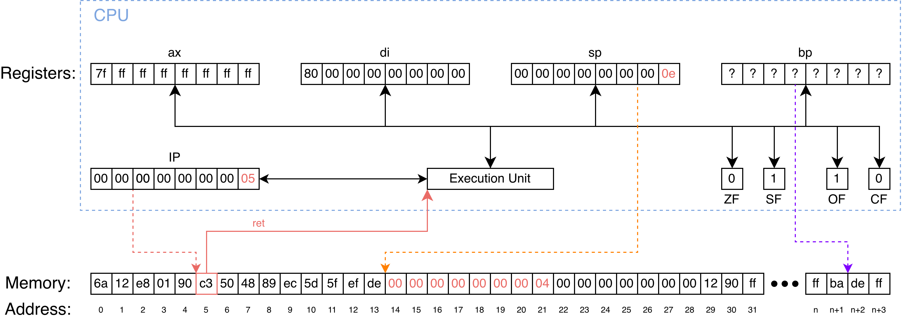

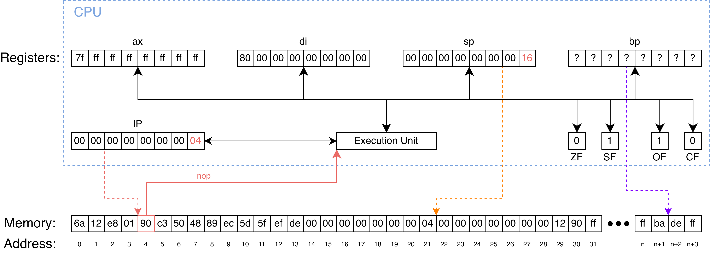

## Appendix: General-Purpose Registers

### Legacy Registers

```
r-               e-       -    -l     <- prefix/suffix
┌────────────────┬────────┬────┬────┐
│%rax            │%eax    │%ax │%al │
└────────────────┴────────┴────┴────┘
8                4        2    1      <- size(byte)
```

| Name | Usage                     | Name | Usage        |
| ---- | ------------------------- | ---- | ------------ |
| ax   | return value              | di   | 1st argument |
| sp   | stack pointer             | si   | 2nd argument |
| bp   | base pointer/callee saved | dx   | 3rd argument |
| bx   | callee saved              | cx   | 4th argument |

### Modern Registers

```
-                 -d       -w   -b    <- suffix
┌────────────────┬────────┬────┬────┐
│%r8             │%r8d    │%r8w│%r8b│
└────────────────┴────────┴────┴────┘
8                4        2    1      <- size(byte)
```

| Name | Usage        | Name | Usage        |
| ---- | ------------ | ---- | ------------ |
| r8   | 5th argument | r12  | callee saved |
| r9   | 6th argument | r13  | callee saved |
| r10  |              | r14  | callee saved |
| r11  |              | r15  | callee saved |

## Appendix: Instructions

Suffixes: 8-byte: **q**uad, 4-byte: **l**ong, 2-byte: **w**ord, 1-byte: **b**yte

### Move

| Instruction | Effect                   | Operands                      | Suffixes                                       |
| ----------- | ------------------------ | ----------------------------- | ---------------------------------------------- |
| MOV S,D     | D <- S                   | S: Imm, Reg, Mem; D: Reg, Mem | movb, movw, movl, movq                         |
| movabsq I,R | R <- I                   | I: Imm; R: Reg                | —                                              |
| MOVZ S,R    | R <- ZeroExtend(S)       | S: Reg, Mem; R: Reg           | movzbw, movzbl, movzbq, movzwl, movzwq         |
| MOVS S,R    | R <- SignExtend(S)       | S: Reg, Mem; R: Reg           | movsbw, movsbl, movsbq, movswl, movswq, movslq |
| cltq        | %rax <- SignExtend(%eax) | none                          | —                                              |

- MOV cannot go Mem -> Mem.
- movl sets the higher 4 bytes to 0, which is why there is no movzlq.
- movq takes only a 32-bit source immediate and fills the higher 4 bytes with its sign bit; movabsq is the form that takes a full 64-bit immediate, and its destination must be a register.
- cltq means Convert Long To Quad; it takes no operand, the source and the destination are always %eax and %rax.

### Stack

A stack grows toward the lower addresses, and %rsp always holds the address of the top element.

| Instruction | Effect                             | Operands         |
| ----------- | ---------------------------------- | ---------------- |
| pushq S     | %rsp <- %rsp - 8, then (%rsp) <- S | S: Imm, Reg, Mem |
| popq D      | D <- (%rsp), then %rsp <- %rsp + 8 | D: Reg, Mem      |

### Load Effective Address

Get the address itself instead of the value stored at that address.

| Instruction | Effect  | Operands       | Notes                            |
| ----------- | ------- | -------------- | -------------------------------- |
| leaq S,D    | D <- &S | S: Mem; D: Reg | Will not set the condition flags |

### Unary Operations

| Instruction | Effect     | Operands    | Flags                                                       |
| ----------- | ---------- | ----------- | ----------------------------------------------------------- |
| INC D       | D <- D + 1 | D: Reg, Mem | OF, ZF (will not set the CF)                                |
| DEC D       | D <- D - 1 | D: Reg, Mem | OF, ZF (will not set the CF)                                |
| NEG D       | D <- -D    | D: Reg, Mem | CF: 0 if D was 0, otherwise 1; OF, SF, ZF set by the result |
| NOT D       | D <- ~D    | D: Reg, Mem | None                                                        |

### Binary Operations

All take S: {Imm, Reg, Mem} and D: {Reg, Mem}.

| Instruction | Effect      | Flags             |
| ----------- | ----------- | ----------------- |
| ADD S,D     | D <- D + S  | Set by the result |
| SUB S,D     | D <- D - S  | Set by the result |
| IMUL S,D    | D <- D * S  | Set by the result |
| XOR S,D     | D <- D ^ S  | CF:0, OF:0        |
| OR S,D      | D <- D \| S | CF:0, OF:0        |
| AND S,D     | D <- D & S  | CF:0, OF:0        |

### Shift Operations

For a w bits long data, the shift amount is the value of the low-order m bits of %cl, where 2^m = w. In other words, it will not shift over the data's length. All take k: {Imm, %cl} and D: {Reg, Mem}, and set CF to the last bit shifted out. OF is only meaningful for a 1-bit shift, where it depends on the shift direction; for larger shift counts it is undefined.

| Instruction | Effect                  |
| ----------- | ----------------------- |
| SAL k,D     | D <- D << k             |
| SHL k,D     | D <- D << k             |
| SAR k,D     | D <- D >> k, arithmetic |
| SHR k,D     | D <- D >> k, logical    |

### Full Multiply & Divide

These instructions take a single operand S: {Reg, Mem} (except cqto, which takes none); the other operand and the destination are always %rax, or the 128-bit pair %rdx:%rax.

| Instruction | Effect                                          | Notes                                                                     |
| ----------- | ----------------------------------------------- | ------------------------------------------------------------------------- |
| imulq S     | %rdx:%rax <- S * %rax                           | Signed full multiply                                                       |
| mulq S      | %rdx:%rax <- S * %rax                           | Unsigned full multiply                                                     |
| cqto        | %rdx:%rax <- SignExtend(%rax)                   | Convert Quad to Octword; prepares the 128-bit dividend for idivq          |
| idivq S     | %rdx <- %rdx:%rax mod S, %rax <- %rdx:%rax / S  | Signed divide                                                              |
| divq S      | %rdx <- %rdx:%rax mod S, %rax <- %rdx:%rax / S  | Unsigned divide                                                            |

### Compare

Used for setting the condition flags without touching the operands. S1: {Imm, Reg, Mem}, S2: {Reg, Mem}; the two cannot both be Mem.

| Instruction | Effect                                                        | Suffixes                   |
| ----------- | ------------------------------------------------------------- | -------------------------- |
| CMP S1,S2   | Set the condition flags as SUB but do not change the destination  | cmpb, cmpw, cmpl, cmpq     |
| TEST S1,S2  | Set the condition flags as AND but do not change the destination  | testb, testw, testl, testq |

### Control

Used for reading the condition flags and changing the flow of execution. The suffix of these instructions selects the condition; see the suffix table in *Controlling the Flow*.

| Instruction   | Effect                                                 | Operands                                               | Notes                           |
| ------------- | ------------------------------------------------------ | ------------------------------------------------------ | ------------------------------- |
| SET D         | D <- result based on the suffix and the condition flags | D: low-order single byte of Reg, or single byte of Mem |                                 |
| jmp Label     | Direct jump                                             | —                                                      | No condition                    |
| jmp \*Operand | Jump to the address saved in the operand                | Operand: Reg, Mem                                      | Indirect, no condition          |
| J Label       | Conditional jump                                        | —                                                      | Condition depends on the suffix |
| CMOV S,R      | R <- condition ? S : R                                  | S: Reg, Mem; R: Reg                                    | Condition depends on the suffix |
